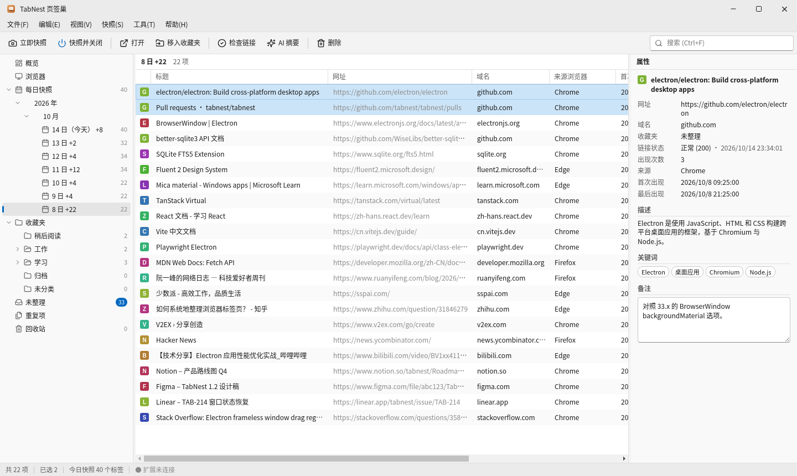
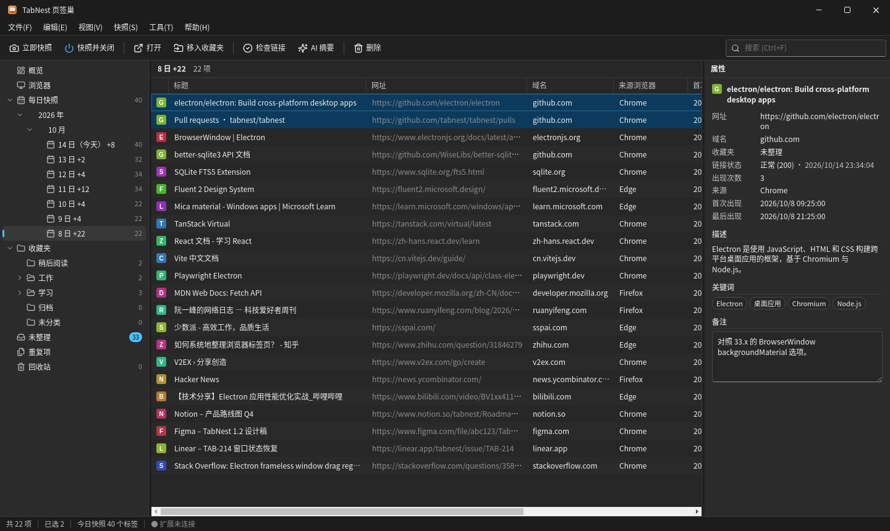
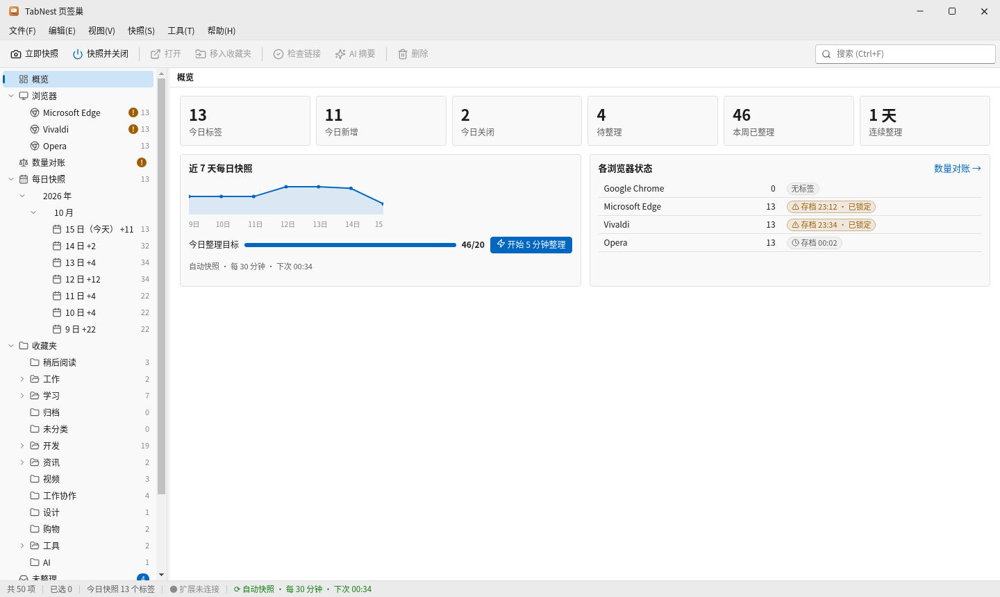
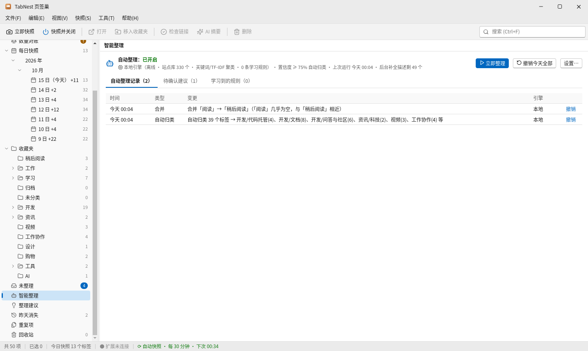

# TabNest 页签巢

**1.4.2** · 浏览器标签页快照与渐进整理工具：把一大堆标签收成可管理的快照，再逐步清理、对账和自动组织。

## 界面截图



*主界面（浅色） / Main window, light theme*



*主界面（深色） / Main window, dark theme*



*总览 / Overview*



*自动整理 / Auto-organize*

## 功能特性

- 为当前浏览器标签建立快照，便于稍后回顾和清理。
- 渐进整理与对账（reconcile），避免一次性关掉所有标签。
- 自动组织能力；支持浅色 / 深色主题。
- Electron + Vite + TypeScript 桌面应用。

## 技术栈

- Electron + electron-vite
- TypeScript
- Vitest

## 从源码运行

源码在仓库根目录。本仓库不包含安装包。

```bash
npm install
npm run dev
npm test
npm run build
```
## 文档

- [源码 README](README.original.md)
- [更新日志](CHANGELOG.md)
- [开发说明](docs/DEVELOPMENT.md)

## 许可证

`package.json` 声明为 MIT。仓库根目录未附带 LICENSE 文件。

---

## English

# TabNest

**1.4.2** · Browser tab snapshot and gradual-cleanup tool: capture a pile of tabs as manageable snapshots, then clean, reconcile, and auto-organize them.

## Screenshots


*主界面（浅色） / Main window, light theme*


*主界面（深色） / Main window, dark theme*


*总览 / Overview*


*自动整理 / Auto-organize*

## Features

- Snapshot open browser tabs so you can review and clean them later.
- Gradual cleanup and reconcile flows, instead of closing everything at once.
- Auto-organize, with light and dark themes.
- Electron + Vite + TypeScript desktop app.

## Tech stack

- Electron + electron-vite
- TypeScript
- Vitest

## Getting started

Source is at the repository root. This repository does not include installers.

```bash
npm install
npm run dev
npm test
npm run build
```
## Documentation

- [源码 README](README.original.md)
- [更新日志](CHANGELOG.md)
- [开发说明](docs/DEVELOPMENT.md)

## License

`package.json` declares MIT. There is no LICENSE file at the repository root.

