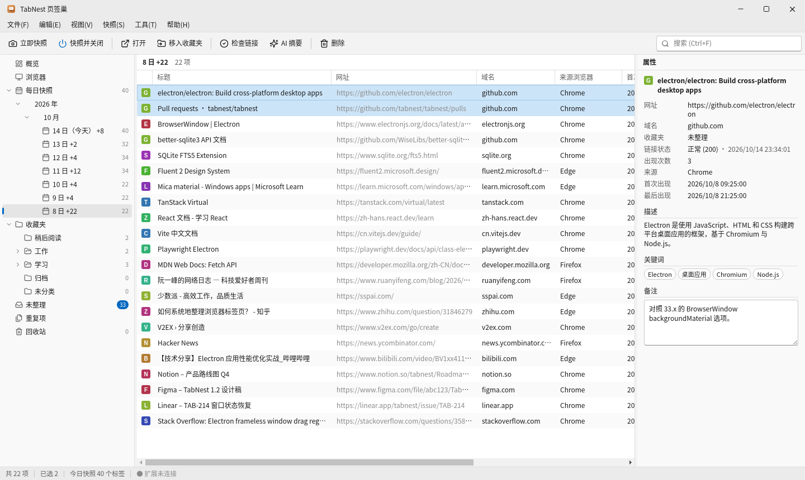
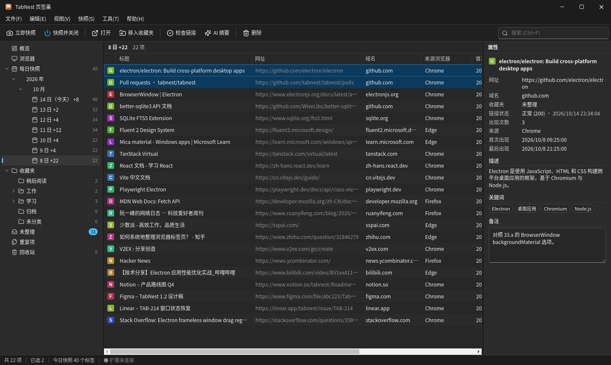
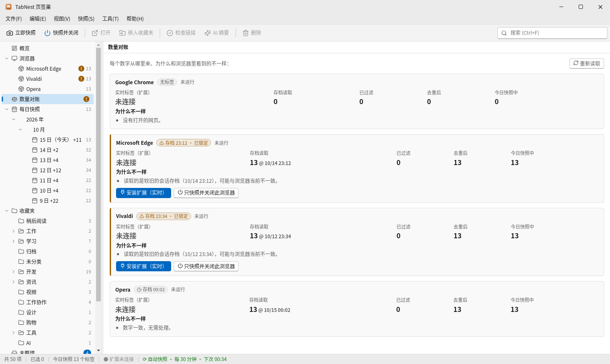
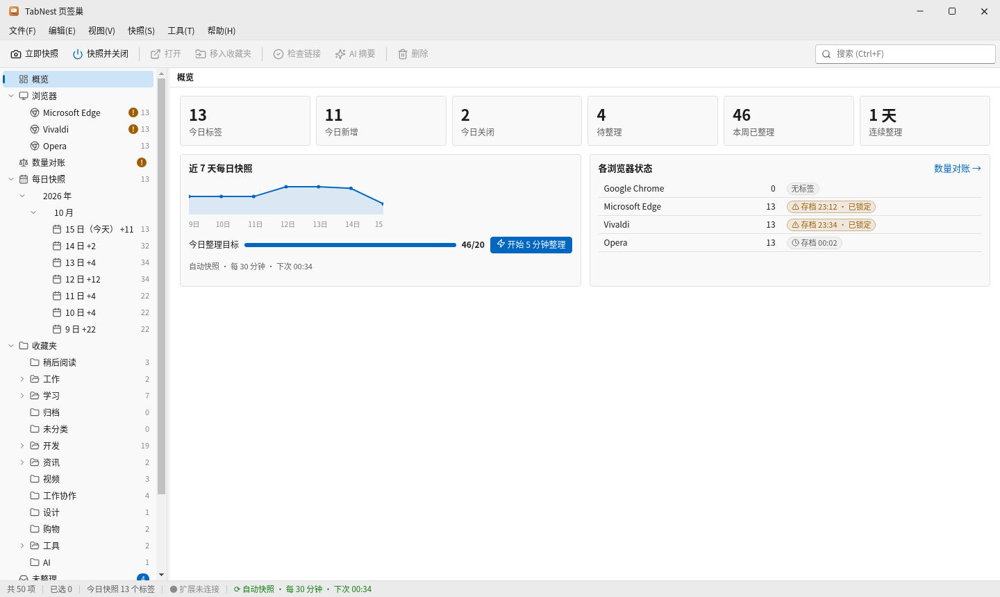
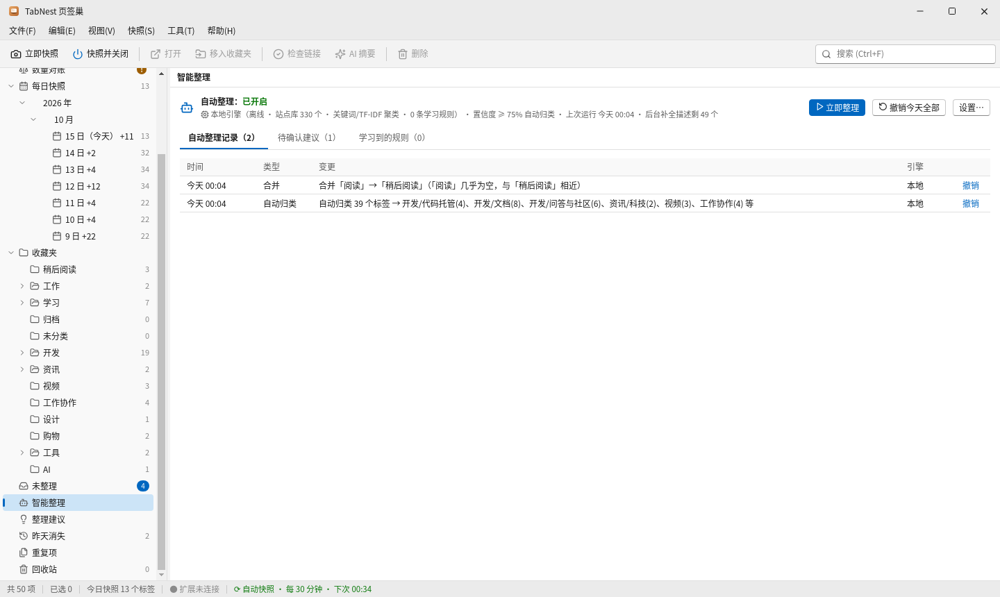

# TabNest 页签巢

> **先快照 → 关浏览器 → 有空再整理**

浏览器开了上百个标签，不敢关，怕关了就找不回来？恢复会话后越开越多，书签也懒得整理，最后干脆放弃？
**TabNest 页签巢**是一个本地桌面应用：先把标签页一键收进「巢」里，放心关掉浏览器，等有空再一点点整理到收藏夹。需要时搜一下，再打开就行。

- 🔒 **数据只在本机**：SQLite 数据库，没有账号，也不上云
- 🇨🇳 中文界面，深色/浅色跟随系统
- 📂 直接读 Chromium / Firefox 会话文件，**无需浏览器扩展**
- 💻 Windows / macOS / Linux

---





界面设计与快捷键见 [docs/DESIGN.md](docs/DESIGN.md)，v1.3 产品方案见 [docs/PRD-v1.3.md](docs/PRD-v1.3.md)。

### v1.3 亮点
- **数量对账**：每个浏览器的数字从哪来、为什么不一样，一键修复。
- **概览**：今日标签 / 新增 / 关闭 / 待整理 / 本周已整理 / 连续整理天数，各浏览器存档状态，7 天趋势。
- **AI 全自动整理**：快照后自动归类、每晚自动调整收藏夹结构、从你的纠正中学习规则，每项变更可撤销；默认完全离线，可选 DeepSeek / 通义千问 / Kimi / OpenAI。
- **锁定浏览器**：Edge / Vivaldi / QQ 运行中锁定会话时，用「只快照并关闭此浏览器」获取最新标签。

## 安装

到 [Releases](https://github.com/tabnest/tabnest/releases) 下载对应系统的安装包：

| 系统 | 文件 | 说明 |
|---|---|---|
| Windows 10/11 | `TabNest-1.3.5-win-x64.exe` | 双击安装，可自选安装目录。未签名时 SmartScreen 会提示，点「更多信息 → 仍要运行」 |
| macOS 11+ | `TabNest-1.3.5-mac-arm64.dmg`（Apple 芯片）/ `…-x64.dmg`（Intel） | 拖到「应用程序」。未签名时首次打开请右键 →「打开」 |
| Linux | `TabNest-1.3.5-linux-x86_64.AppImage` | `chmod +x` 后直接运行（需要 FUSE：`sudo apt install libfuse2`） |
| Debian / Ubuntu | `TabNest-1.3.5-linux-amd64.deb` | `sudo apt install ./TabNest-1.3.5-linux-amd64.deb` |

安装后会自动检查更新（可在「设置」中关闭）。

---

## 小明的一天（推荐用法）

1. **一键收工**：浏览器开了 80 多个标签，电脑开始卡。打开 TabNest，点橙色的 **「⏻ 快照并关闭浏览器」**。
   - 先弹出确认框：列出 Chrome / Edge / Firefox… 各自的标签数。
   - 确认后：全部并入**今日快照**（自动去重）→ 校验保存成功 → 再逐个**正常关闭**浏览器（会等它自己把会话写盘，最多约 10 秒；没退才强制结束）。某个浏览器读不到标签时，默认会跳过关闭，防止误丢。
   - 完成后 toast：「已保存 N 个标签并关闭 X 个浏览器」。
2. **同一天多次快照也不乱**：手动、定时、关机前、粘贴……同一天的所有捕获都会并进**同一个「每日快照」**，按规范化网址去重，只保留最新标题、首次/最近出现时间、来源浏览器和出现次数。时间线里一天一张卡片，标「较前一天新增多少」。
3. **有空再整理**：打开「**未整理**」，每条链接旁边都有建议的收藏夹（比如 GitHub → 工作、知乎 → 稍后阅读），点一下就归好了。批量整理：勾选后按数字键 **1–9**。
4. **找回来 / 打开**：左上角搜索；单条、一组或整个收藏夹都能打开。

> **Edge / Vivaldi / QQ浏览器**：这些浏览器运行时会独占锁定当前会话文件，TabNest 只能读到上一次写盘的快照（界面会标出时间）。要最新数字，请用**「只快照并关闭此浏览器」**：先正常关闭 → 浏览器写出最新会话 → TabNest 再读取。「快照并关闭所有浏览器」对锁定浏览器也是同样顺序。
>
> QQ 浏览器部分书签文件（`Bookmarks_NN`，QBCI 头）是加密的，桌面端读不了；会话文件快照不受影响。

---

## 功能

| 功能 | 说明 |
|---|---|
| **每日快照** | **一天一个去重快照**：当天所有捕获（手动 / 定时 / 关机前 / 粘贴）合并为一张「日卡」。按规范化网址去重，保留最新标题、首次/最近出现时间、来源浏览器和出现次数；已整理进收藏夹的标签仍然关联。时间线显示「较前一天新增」。老版本多个会话会自动按天合并。 |
| **一键关闭浏览器** | 主页 / 托盘 / Ctrl/⌘+K 命令面板都能触发。流程：读标签 → 写入今日快照 → 确认 → 优雅关闭（Windows `taskkill` 不带 `/F`；macOS AppleScript quit；Linux SIGTERM）。可选「完成后关机」（默认关，每次再确认）。某浏览器快照失败则永不关闭它。 |
| 粘贴快照 | 粘贴网址会**并入今日快照**，不会再冒出一堆零散会话 |
| 未整理收件箱 | 所有还没归档的标签；推荐收藏夹、整组归档、数字键快捷移动 |
| 收藏夹 | 内置「稍后阅读 / 工作 / 学习 / 未分类」，也可以自己新建、重命名、删除 |
| 全文搜索 | SQLite FTS5 全文索引，覆盖标题、网址、摘要、关键词 |
| 重复链接 | 跨会话找出重复网址（自动忽略 www、utm 等跟踪参数和 #锚点），一键合并 |
| 链接检查 | 检查链接是否失效：有效 / 重定向 / 失效 / 超时；可设置并发数，带进度条，可以随时取消 |
| 智能摘要 | 为每个链接生成中文简介和关键词。默认**本地生成**（离线可用）；在「设置」里填入 API Key 后可使用云端 AI（兼容 OpenAI 接口） |
| 导入书签 | 导入 Chrome / Edge / Firefox / Safari 导出的书签 HTML，可以按书签文件夹放进收藏夹 |
| 备份 | 每天自动备份；可手动导出/恢复 JSON；**导出书签 HTML**，任何浏览器都能导回去 |
| 桌面体验 | 系统托盘、全局快捷键、开机自启、记住窗口位置和大小、原生菜单 |

### 快捷键

| 快捷键 | 作用 |
|---|---|
| Ctrl/⌘ + Shift + S | （全局）立即快照，并入今日 |
| Ctrl/⌘ + K | 命令面板（含「快照并关闭浏览器」） |
| Ctrl/⌘ + 1 / 2 / 3 / 4 | 时间线 / 未整理 / 收藏夹 / 重复 |
| Ctrl/⌘ + F | 搜索 |
| Ctrl/⌘ + , | 设置 |
| 1 – 9 | （未整理中）把选中项移入第 n 个收藏夹 |
| Ctrl/⌘ + A / Esc | （未整理中）全选 / 取消选择 |

---


---

## 数据与隐私

| 内容 | 位置 |
|---|---|
| 数据库 | Windows `%APPDATA%\TabNest\tabnest.db` · macOS `~/Library/Application Support/TabNest/tabnest.db` · Linux `~/.config/TabNest/tabnest.db` |
| 自动备份 | 同目录下 `backups/`（可在设置中修改），保留最近 14 份 |
| 日志 | 「帮助 → 打开日志目录」 |

- 不会主动联网。只有这些操作会联网：检查链接、显示网站图标（Google favicon 服务）、检查更新，以及你自己配置的云端 AI
- AI 密钥用系统密钥库加密保存（Windows DPAPI / macOS 钥匙串 / Linux libsecret）
- 从 0.x 升级时，旧的 `tabnest.json` 会在首次启动时自动导入，原文件会改名为 `.migrated` 保留

---

## 开发者

见 [docs/DEVELOPMENT.md](docs/DEVELOPMENT.md)。

```bash
npm install
npm run dev        # 开发模式
npm run verify     # 类型检查 + lint + 格式 + 单元测试 + 构建
npm run dist:linux # 打包 AppImage + deb
```

## 许可

MIT
